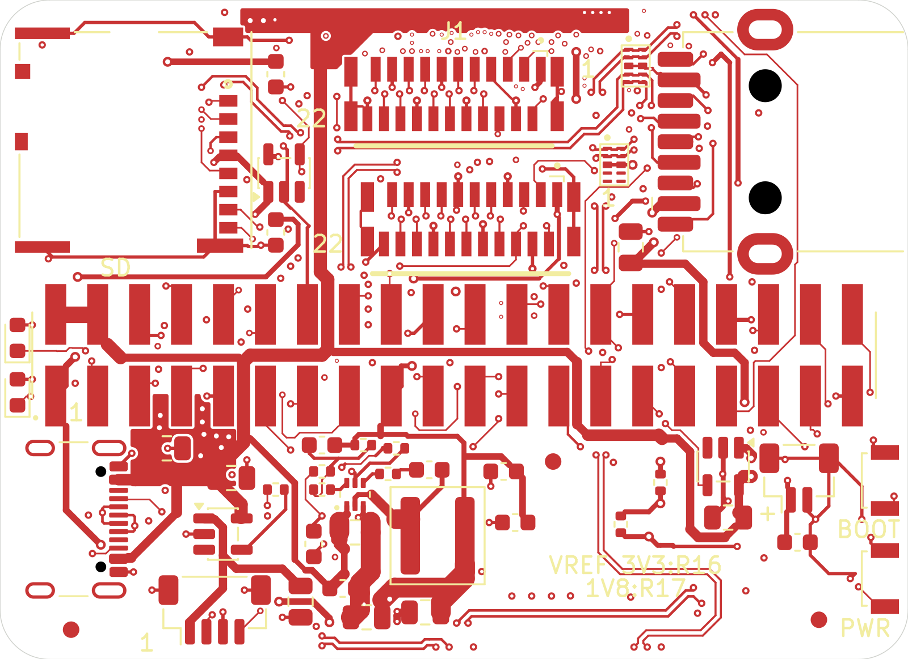
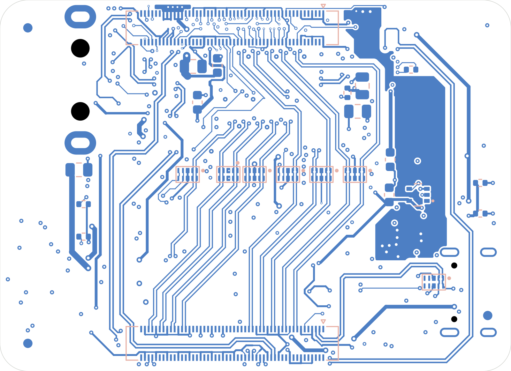

# Astra CM5 Nano

55 × 40 mm carrier board for the Raspberry Pi Compute Module 5.

## Specifications

| Item | Specification |
|---|---|
| Board size | 55 × 40 mm |
| Copper layers | 8 |
| Board thickness | 1.5936 mm |
| Module | Raspberry Pi CM5 / CM5 Lite |
| USB-C | 5 V input and USB 2.0 device port |
| USB Type-A | USB 3.0 host port |
| CSI / DSI | Two 22-pin, four-lane ports |
| GPIO | 40-pin SMT header; 3.3 V reference by default (R16 fitted, R17 DNP). For 1.8 V, remove R16 and fit R17; never fit both. |
| microSD | For CM5 Lite |
| Auxiliary connectors | Four-pin fan and two-pin RTC battery |
| Controls and indicators | BOOT and PWR buttons; power and activity LEDs |
| Status | Not built or tested. |

## Files

| File | Location |
|---|---|
| Native KiCad project | [hardware/cm5-nano-compatible/](hardware/cm5-nano-compatible/) |
| Full schematic | [PDF](docs/exports/schematic-full.pdf) · [SVG](docs/exports/schematic-full.svg) · [PNG](docs/exports/schematic-full.png) |
| Focused schematic pages | [PDF](docs/exports/schematic-focused-pages.pdf) |
| PCB layers | [PDF](docs/exports/pcb-layers.pdf) · [SVG](docs/exports/pcb-layers/layers.svg) · [copper-layer SVGs](docs/exports/copper-layers/) |
| Bill of materials | [Detail CSV](assembly/cm5-nano-compatible-BOM-detail.csv) · [JLCPCB CSV](assembly/cm5-nano-compatible-BOM-JLCPCB.csv) |
| Component positions | [CPL CSV](assembly/cm5-nano-compatible-CPL-kicad-native.csv); KiCad-native placement coordinates, no assembler-specific adjustments |

Vendor 3D models are not included.

Open `hardware/cm5-nano-compatible/cm5-nano-compatible.kicad_pro` in KiCad 10.

Reference: [Waveshare CM5-NANO-A](https://www.waveshare.com/cm5-nano-a.htm).

## License

Original project contributions: [CERN-OHL-P-2.0](LICENSE). Third-party material retains its original terms; see [THIRD_PARTY.md](THIRD_PARTY.md) and [LICENSES/](LICENSES/).
